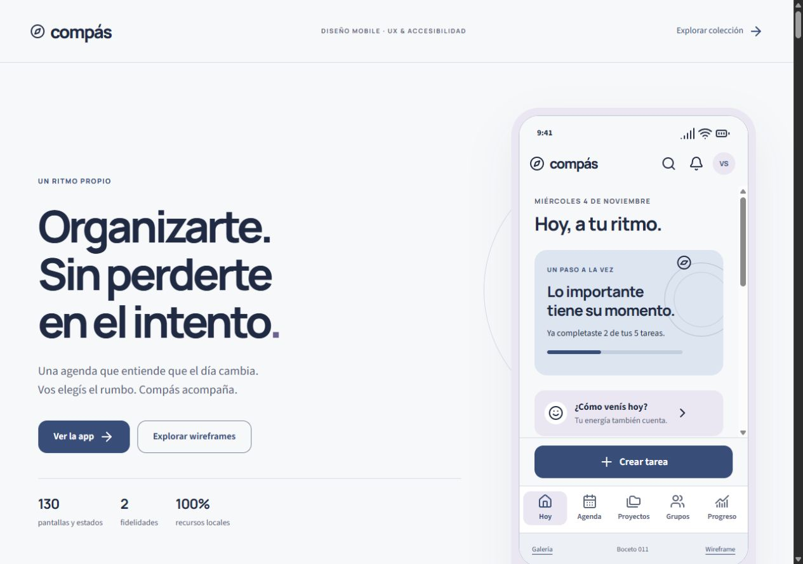
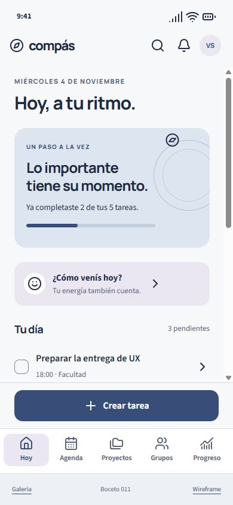
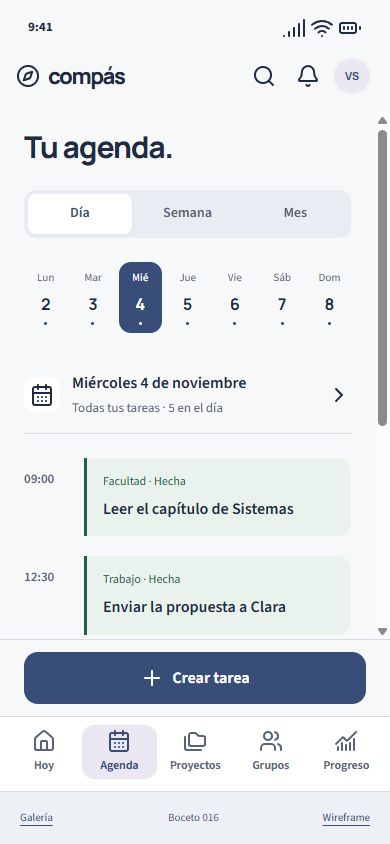
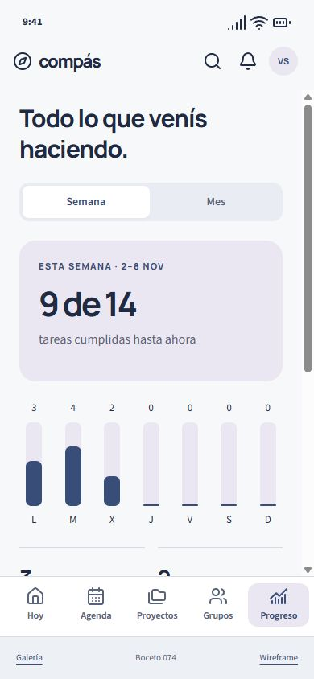

<div align="center">

# Compás

### Un ritmo propio.

Diseño UX/UI de una aplicación mobile para organizar tareas, sostener compromisos y elegir cómo recibir acompañamiento.

**130 pantallas y estados · 2 fidelidades · HTML, CSS y JavaScript · Recursos locales**

[Explorar la colección](index.html) · [Pantalla principal](pantallas/hoy.html) · [Ver wireframes](wireframes/hoy.html)

</div>



## El proyecto

Compás propone una organización que contempla el contexto: días con poca energía, imprevistos, tareas compartidas y cambios de planes. La persona puede elegir entre usar solo la agenda o sumar avisos de presión, bloqueo de redes sociales y gamificación.

La interfaz busca transmitir claridad y autonomía. El acompañamiento es opcional; las reglas, los cupos disponibles y los efectos de cada decisión se muestran antes de confirmar.

El proyecto se desarrolla como trabajo de **UX y Accesibilidad de UTN FRBA**, a partir de la consigna y el material de cursada proporcionados. Los datos de las pantallas son ejemplos; no representan resultados de una investigación nueva.

## Vista previa

<table>
  <tr>
    <th>Hoy</th>
    <th>Agenda</th>
    <th>Progreso</th>
  </tr>
  <tr>
    <td></td>
    <td></td>
    <td></td>
  </tr>
</table>

## Qué incluye

| Área | Cobertura |
| --- | --- |
| Acceso y primera experiencia | Registro, inicio de sesión, recuperación, onboarding y explicación de permisos. |
| Organización personal | Hoy, mood y energía, resumen de ayer, agenda diaria, semanal y mensual, filtros y búsqueda. |
| Tareas y proyectos | Creación por texto, audio o foto; revisión del reconocimiento; edición, asignación y eliminación. |
| Cumplimiento | Completar, deshacer, registrar decisiones e imprevistos, reprogramar y gestionar dependencias. |
| Trabajo compartido | Grupos, invitaciones, integrantes con iguales permisos y tareas con varios responsables. |
| Motivación y seguimiento | Amigos, historial, estadísticas, rachas personales y grupales, puntos, niveles y ranking. |
| Acompañamiento | Consecuencias opcionales, umbral configurable, selección de redes, bloqueo y pausas. |
| Estados de interfaz | Vacíos, carga, errores, falta de conexión, permisos denegados, límites y confirmaciones. |

Cada pantalla tiene una versión de **alta fidelidad** y un **wireframe estructural en grises**. Ambas comparten contenido, jerarquía y navegación de referencia.

### Alcance de los bocetos

Los archivos representan el diseño de la aplicación. Los enlaces permiten recorrer pantallas prediseñadas; **no ejecutan operaciones reales**. Los formularios muestran datos de ejemplo y no guardan cambios.

No hay backend, autenticación, grabación de audio, reconocimiento de imágenes, acceso a contactos, envío de notificaciones ni bloqueo efectivo de aplicaciones. El buscador de la galería únicamente filtra los archivos de la colección. No se usan analíticas ni servicios externos durante la consulta.

Los enlaces a archivos HTML en GitHub permiten consultar su código. Para ver la interfaz renderizada, descargá o cloná el repositorio y abrí `index.html` en un navegador.

## Cómo abrirlo

### Sin instalación

1. Descargá o cloná el repositorio completo.
2. Abrí **`index.html`** con tu navegador.
3. Elegí una sección y consultá **Diseño** o **Wireframe**.

Conservá las carpetas `assets/`, `pantallas/` y `wireframes/` junto a `index.html`. Las fuentes, los iconos y los estilos están incluidos, por lo que la colección funciona sin conexión.

### Con servidor local — opcional

Si tenés Python instalado, ejecutá desde la raíz del repositorio:

```powershell
python -m http.server 8000 --bind 127.0.0.1
```

Después abrí [localhost:8000](http://localhost:8000). No requiere instalar paquetes.

## Criterio visual

Una identidad **serena, contemporánea, cercana y firme**, con composiciones diferentes para listas, planificación, formularios y resúmenes.

| Elemento | Decisión |
| --- | --- |
| Tipografía de títulos | Manrope, con una jerarquía marcada y pesos variables. |
| Tipografía de lectura | Source Sans 3, con cuerpo base de 16 px y tamaños relativos. |
| Fondo | Blanco cálido `#F7F8FA`. |
| Texto | Azul tinta `#202A43`. |
| Acción principal | Azul `#384D78`. |
| Superficie secundaria | Lavanda grisácea `#EAE7F2`. |
| Iconografía | Lucide, con un único estilo de trazo. |
| Composición | Referencia de 390 × 844 px, márgenes de 24 px y espaciado basado en 8 px. |

Los colores de éxito, advertencia y error se acompañan con texto e iconos. El bloqueo tiene un tratamiento propio para diferenciarlo de un error de la aplicación.

## Accesibilidad y revisión

El diseño toma **WCAG 2.2 nivel AA** como objetivo para los criterios aplicables a estos archivos estáticos.

- HTML semántico, idioma declarado, un título principal por página y etiquetas persistentes en los campos.
- Navegación por enlaces nativos, foco visible y áreas de interacción de al menos 44 × 44 px en los controles activos.
- Color acompañado por texto, estados explícitos y alternativas de entrada escrita frente a audio o foto.
- Contenido desplazable separado de la navegación para evitar que los controles cubran la lectura.
- Recursos locales y ausencia de animaciones que distraigan.

**Verificaciones realizadas con servidor local:** estructura y enlaces de toda la colección; recursos locales; vistas a 320, 390 y 430 px; revisión de escritorio; y texto ampliado al 200 %. Las combinaciones principales de texto verificadas superan 4,5:1 y los bordes de controles superan 3:1.

Estas comprobaciones **no equivalen a una certificación integral de accesibilidad**. La validación de una aplicación funcional con lectores de pantalla y personas usuarias queda pendiente. No se presentan entrevistas ni pruebas con usuarios como realizadas.

## Estructura

```text
UX-UI/
├── index.html              # Galería y búsqueda de pantallas
├── pantallas/              # 130 diseños de alta fidelidad
├── wireframes/             # 130 versiones estructurales en grises
├── assets/
│   ├── app.css             # Tokens y componentes compartidos
│   ├── wireframe.css       # Adaptación visual de baja fidelidad
│   ├── gallery.css         # Presentación de la colección
│   ├── gallery.js          # Filtro local de la galería
│   ├── fonts/              # Fuentes y licencias OFL
│   └── icons/              # Iconos SVG y licencia de Lucide
├── docs/images/            # Capturas reales para este README
└── tools/
    ├── build_compas.py      # Fuente y generador de las pantallas
    └── check_compas.py      # Verificación de estructura y recursos
```

### Editar y regenerar

El inventario, el contenido y las plantillas están en `tools/build_compas.py`. Los estilos se editan directamente en `assets/`.

Después de modificar el contenido, regenerá los HTML desde la raíz:

```powershell
python tools/build_compas.py
```

Para verificar enlaces, anclas, recursos, etiquetas y equivalencia de inventarios:

```powershell
python tools/check_compas.py
```

El generador usa únicamente la biblioteca estándar de Python. Sobrescribe `index.html`, `pantallas/` y `wireframes/`; los cambios de contenido deben hacerse en el generador para conservarlos. La carpeta `.work/` contiene archivos temporales y está excluida de Git.

## Referencias y recursos

Como referencias de producto se consultaron [Things](https://culturedcode.com/things/), [Structured](https://structured.app/), [Todoist](https://www.todoist.com/) y [Opal](https://opalapp.com/). La identidad visual y las pantallas de Compás son una propuesta propia.

- [WCAG 2.2 — W3C](https://www.w3.org/TR/WCAG22/).
- [Manrope — SIL Open Font License](assets/fonts/Manrope-OFL.txt).
- [Source Sans 3 — SIL Open Font License](assets/fonts/SourceSans3-OFL.txt).
- [Lucide — licencia incluida](assets/icons/LICENSE.txt).

Los PDFs de la cursada y los materiales personales de investigación no se incorporan al repositorio.
